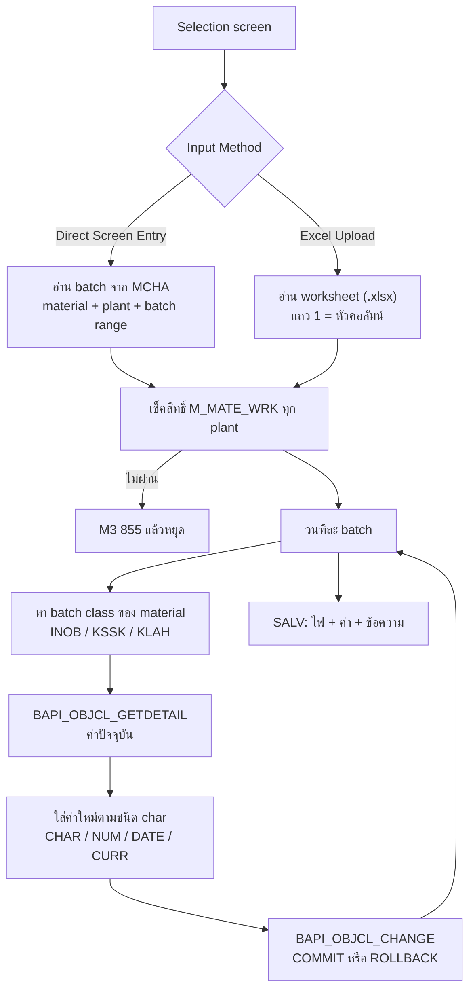

# ZMME004 — Update Batch Characteristic

QC ใช้โปรแกรมนี้อัปเดตค่า batch characteristic (class type 023) หลังตรวจสินค้าที่ผลิตเองและ coil
โดยเลือกได้ 2 วิธี คือกรอกบนหน้าจอ (ค่าชุดเดียวกันลงทุก batch ในช่วงที่เลือก)
หรืออัปโหลด Excel (หนึ่งแถวต่อหนึ่ง batch) จากนั้นแสดง ALV บอกผลทีละ batch
รันแบบ online ผ่าน T-code `ZMME004`

> ขอบเขต: ยุบ ZMMI002 (GJS) กับโปรแกรมที่มันเรียก คือ ZMME03_PLEDGE (เฉพาะ path pledge)
> และ FM `ZCA_UPDATE_BATCH_CHAR` / `ZCA_GET_OBJ_CLASS` ให้เหลือโปรแกรมเดียว ไม่พึ่ง FG ZCA01
> หน้าจอเปลี่ยนตาม design ใหม่ (Direct Screen Entry / Excel Upload) ดูรายละเอียดที่
> [สิ่งที่ตั้งใจเปลี่ยน](#สิ่งที่ตั้งใจเปลี่ยนจาก-zmmi002--zmme03_pledge)

RICEFW: แถว 21 (ZMME004) ใน `THE_RICEFW_List_V2.0_PP_ABAP_Estimate_20261103.xlsx`

## โปรแกรมทำอะไร

กติกาหลัก: อัปเดตเฉพาะ characteristic ที่มีค่า ช่องว่างไม่แตะค่าเดิม ถ้าต้องการล้างค่าให้ใส่คำว่า `BLANK`
(ตัวพิมพ์ใดก็ได้) characteristic ที่ไม่อยู่ใน batch class ของ material ทำให้ batch นั้น error ทั้งแถว
ไม่มีการอัปเดตบางส่วน ค่าแบบ single value จะทับของเดิม ส่วน multiple value จะเพิ่มต่อจากค่าที่มีอยู่
แต่ละ batch commit แยกกัน แถวที่ error จะไม่กระทบแถวอื่น

## Selection screen

| Object | ชนิด | Text | หมายเหตุ |
|---|---|---|---|
| `R_SCR` / `R_XLS` | Radio | Direct Screen Entry / Excel Upload | สลับ block ที่แสดง |
| `P_MATNR` | Parameter | Material | โหมดจอ |
| `P_WERKS` | Parameter | Plant | โหมดจอ |
| `S_CHARG` | Select-option (NO-EXTENSION) | Batch | ว่าง To = batch เดียว |
| `P_ATN1`–`P_ATN5` | Parameter + F4 + ปุ่มล้าง | Characteristic | F4 กรองตาม batch class ของ material บนจอ |
| `P_VAL1`–`P_VAL5` | Parameter (lower case) | Value | |
| `P_FILE` | Parameter + F4 | File name | เลือกไฟล์แล้วโหลดรายชื่อ sheet ทันที |
| `P_SHEET` | Listbox | Worksheet | ว่าง = sheet แรก |

Text symbols: `B01` Input Method, `B02` Option Update, `B03` File Path, `C01` Characteristic,
`M01` Direct Screen Entry, `M02` Excel Upload, `N01`/`N02` หมายเหตุใต้ block

### Excel layout

| A | B | C | D … |
|---|---|---|---|
| Material | Plant | Batch | ชื่อ characteristic เช่น `ZMM_LOCATION_CODE`, `ZSO_BOI_NO`, `ZQM_UDCODE` |

- 3 คอลัมน์แรกอ่านตามตำแหน่ง ไม่สนชื่อหัวคอลัมน์ ตั้งแต่ D เป็นต้นไปหัวคอลัมน์ต้องเป็นชื่อ characteristic
- คอลัมน์ที่หัวว่างจะถูกข้าม แถวที่ A–C ว่างทั้งหมดก็ถูกข้าม
- Material ผ่าน `MATN1` ส่วน Plant กับ Batch ผ่าน `ALPHA` (cell ตัวเลข `996211` จะกลายเป็น `0000996211`)
- characteristic ชนิด DATE รับได้ทั้ง `YYYYMMDD`, `DD.MM.YYYY` และ cell วันที่ของ Excel (serial)

## โครงไฟล์

| ไฟล์ | หน้าที่ |
|---|---|
| `zmme004.prog.abap` | REPORT + event ทั้งหมด เรียก method อย่างเดียว |
| `zmme004_top.prog.abap` | TYPES กลาง (`ty_char_value`, `ty_batch_row`, `ty_result`) |
| `zmme004_s01.prog.abap` | Selection screen |
| `zmme004_d01.prog.abap` | Class definition |
| `zmme004_p01.prog.abap` | Class implementation |

แยกเป็น 4 class ตามหน้าที่: `lcl_workbook` (อ่าน .xlsx, cache ไฟล์ล่าสุดไว้เพื่อไม่ต้อง upload ซ้ำตอน F4 กับตอนรัน),
`lcl_batch_char` (อ่านและอัปเดต classification แทน FG ZCA01), `lcl_screen` (event ของ selection screen)
และ `lcl_app` (flow หลัก + ALV) ส่วน `lcx_error` เป็น exception ที่มีข้อความสำหรับแสดงผู้ใช้

### ตาราง FORM → METHOD

| เดิม | Method | ทำอะไร |
|---|---|---|
| ZMMI002 `f4_get_filename` | `lcl_screen=>f4_file` | เลือกไฟล์ + เติม listbox worksheet |
| `upload_file` | `lcl_app->read_excel`, `lcl_workbook=>read_sheet` | อ่าน sheet เป็นแถว |
| `built_table_upload` | `lcl_app->build_output_table` | สร้างตาราง dynamic สำหรับ ALV |
| `convert_exit` | `lcl_app=>to_matnr`, `alpha_in` | แปลง key |
| `update_batch_char` | `lcl_app->update_batches` | วนทีละ batch |
| FM `ZCA_UPDATE_BATCH_CHAR` | `lcl_batch_char->update`, `apply_value`, `set_char_value` | GETDETAIL → ใส่ค่า → CHANGE |
| FM `ZCA_GET_OBJ_CLASS` | `lcl_batch_char->batch_class` | หา batch class ของ material |
| `show_output_pld`, `set_fcat_output`, `show_alv_output` | `lcl_app->show_result`, `set_column_texts` | SALV |
| AUTHORITY-CHECK `M_MATE_WRK` ใน `upload_file` | `lcl_app->check_plant_authority` | เช็คสิทธิ์ plant |

ไม่ได้ยกมา: path unpledge ทั้งหมด (`search_mat_batch_by_char`, screen 100, `update_status`, `undo_update`,
`check_lock`, …) เพราะ ZMMI002 ส่ง `r_pledge = 'X'` ตายตัว, `show_f4_help` (ไม่มีใครเรียก),
`check_coil_pledged` / `check_coil_balance` / เช็ควันที่ pledge (ทำงานเฉพาะ `sy-tcode = 'ZMME03_1'`)

## สิ่งที่ตั้งใจเปลี่ยนจาก ZMMI002 / ZMME03_PLEDGE

1. โปรแกรมเดียว ไม่มี `SUBMIT` และไม่เรียก FG ZCA01 / TYPE-POOL ZERP
2. เพิ่มโหมด Direct Screen Entry (ไม่มีในของเดิม) ตาม design ใหม่
3. อ่าน Excel ด้วย `cl_gui_frontend_services=>gui_upload` + `cl_fdt_xl_spreadsheet` แทน
   `KCD_EXCEL_OLE_TO_INT_CONVERT` ซึ่งใช้ OLE และใช้ไม่ได้บน SAP GUI for HTML ผลคือรับเฉพาะ `.xlsx`
   และเลือก worksheet ได้
4. ตัดหน้าตัวอย่าง Excel template บน selection screen ของ ZMMI002 (text `T00`–`V06`) ตาม design ใหม่
5. ตัดเช็คสิทธิ์ `ZMME03_SD` / `ZMME03_MM` / `ZMME03_QM` (เช็คตาม prefix ชื่อ characteristic)
   เพราะเป็น object ของ GJS ถ้าต้องการให้สร้าง object ใหม่แล้วเพิ่มกลับ
6. หา batch class ไม่ตัด clint `765` / `766` และ class `ZMM_INFO%` แบบของเดิม เพราะเป็นค่าเฉพาะระบบ GJS
7. ค่า `BLANK` ล้างในการเรียก `BAPI_OBJCL_CHANGE` ครั้งเดียวกัน ไม่ต้องเรียกรอบสองและไม่ต้อง `WAIT UP TO 10 SECONDS`
8. ตัด logic ที่ IMPORT จาก memory ID `ZFG_MAT_SPEC` / `ZUD_MAT_SPEC` / `ZNEWMAT_IND` (ใช้เฉพาะตอนถูกเรียกจาก ZQMI003)
9. characteristic ที่ไม่อยู่ใน class → error ทั้งแถวพร้อมข้อความ (ของเดิมปล่อยให้ BAPI ตอบ)
10. แถวที่ไม่มีค่าให้อัปเดตขึ้นข้อความ `No value to update` (ของเดิมไฟแดงแต่ข้อความว่าง)
11. Description ของ characteristic บน ALV ใช้ภาษา logon (`sy-langu`) ของเดิมใช้ `E`
12. ยังไม่รองรับการแยกหลายค่าในช่องเดียว (`split_mult_val` ของเดิม) เพราะไม่ได้รับ source ของ FORM นี้

### Quirk ที่คงไว้ตามต้นฉบับ

- เช็คสิทธิ์ plant ด้วย `M_MATE_WRK` `ACTVT = 03` (display) ทั้งที่โปรแกรมแก้ข้อมูล ถ้า plant ใดไม่ผ่านจะหยุดทั้งไฟล์
- ไม่เช็คว่า batch มีอยู่จริงในโหมด Excel ปล่อยให้ BAPI ตอบ error กลับมา
- object key ใช้ `MCH1` (batch ระดับ material/client) = material 40 ตัว + batch

## Config — ZTCA001

ไม่มี ค่าที่เป็น constant ใน code: class type `023`, object table `MCH1` / `MARA`, auth object `M_MATE_WRK`
ทั้งหมดเป็นค่ามาตรฐานของ SAP

## สิ่งที่ต้องทำฝั่ง SAP

- [ ] รัน `_ref/yzmme004_testdata.abap` (สร้างเป็น `YZMME004_TESTDATA` ใน `$TMP`, SELECT อย่างเดียว)
      ไฟล์ออกที่ `D:\for_query\zmme004.json` เพื่อยืนยัน
      batch level (`TCUCH`), batch class / characteristic ที่ใช้จริง และ INOB ของ MARA/MCH1
- [ ] Pull ผ่าน abapGit แล้ว syntax check ZMME004 (abaplint ผ่านแล้ว แต่ไม่ได้ตรวจ signature ของ
      `cl_fdt_xl_spreadsheet`, `cl_salv_*`, `cl_gui_frontend_services` เพราะไม่มี stub)
- [ ] เช็ค text symbols / selection texts ใน SE38 (ส่งมากับ XML แล้ว)
- [ ] ทดสอบ Excel บน SAP GUI for HTML: เลือกไฟล์ → listbox แสดง sheet → Execute
- [ ] ทดสอบค่า `BLANK`, characteristic ชนิด DATE / NUM และ multiple value
- [ ] คุยกับ functional เรื่องข้อ 5 (สิทธิ์ตามกลุ่ม characteristic) และ material type Z10/Z20/Z50 ว่าต้องจำกัดไหม
